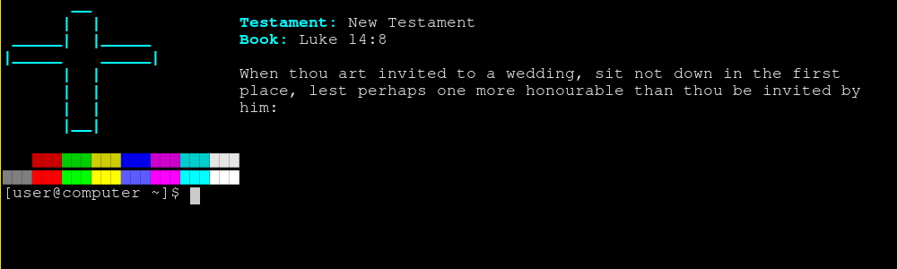
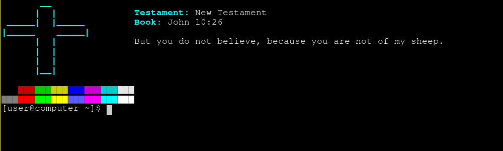

# versefetch
Bible in the terminal!



## Usage
```
$ versefetch                  # random verse
$ versefetch psalms           # random verse from a book
$ versefetch 1 kings 3        # random verse from a chapter
$ versefetch john 3:16        # a specific verse
```
For more help:
```
$ versefetch --help
```
Book names follow the Douay-Rheims (e.g. `Apocalypse`, `Isaias`, `1 Kings`) and are case-insensitive.

### Building
Simply run the following:
```
$ chmod u+x install.sh
$ install.sh
```
