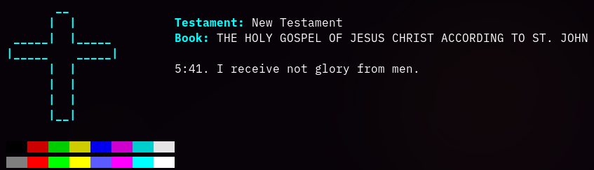

# versefetch
Bible in the terminal!



## Usage
### Configuration
All configuration is done via `src/config.h`.
### Building
Simply run the following (root privileges are needed for installation):
```
$ make clean install
```
### Running
```
$ versefetch
```
